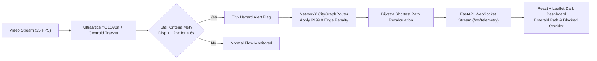

# SafeRoute-AI // Dynamic Emergency Vehicle Rerouting Engine & CV Incident Detector

> **Autonomous Real-Time Emergency Navigation powered by Computer Vision & Graph Theory**

SafeRoute-AI is a computer vision traffic incident detector and dynamic emergency vehicle rerouting engine. When a vehicle halts or creates an obstruction in a simulated video feed, the system triggers real-time graph recalculations and immediately alters emergency routes via a full-stack dashboard.

---

## 🏛 System Architecture



### Core Components

1. **`backend/router.py` (`CityGraphRouter`)**:
   - Built on **NetworkX** representing a downtown street grid.
   - Connected nodes: `N_AMBULANCE_BASE`, `INT_A`, `INT_B`, `INT_C`, `INT_D`, `N_INCIDENT_ZONE`, `N_HOSPITAL`.
   - Dynamic edge impedance: Blocked edges receive a **9999.0** penalty weight.
   - Computes Dijkstra shortest path with geospatial coordinates, ETA, and hop metrics.

2. **`backend/detector.py` (`IncidentDetector`)**:
   - Employs **Ultralytics YOLOv8n** (`yolov8n.pt`) and OpenCV.
   - Tracks target vehicle classes: `car`, `motorcycle`, `bus`, `truck`.
   - **Centroid Velocity Tracking**: Tracks coordinates across frames.
   - **Stall Rule**: If coordinate displacement remains under **12 pixels** for longer than **6.0 seconds**, the vehicle is flagged as stalled and an incident alert is tripped.

3. **`backend/main.py` (FastAPI + WebSocket)**:
   - Ingests `data/sample_traffic.mp4` (auto-synthesizes if missing).
   - Runs detection on each frame.
   - Recalculates emergency routes via `CityGraphRouter` when hazards emerge.
   - Streams base64-encoded annotated JPEG frames and JSON payloads at 25 FPS over `/ws/telemetry`.

4. **`frontend` (React + Vite + Tailwind CSS + Lucide Icons + React-Leaflet)**:
   - **`TacticalMap.jsx`**: CartoDB dark tile layer, rendering city nodes, network edges (dashed red for blocked), and the computed emergency path in **emerald-green**.
   - **`VideoFeed.jsx`**: Live annotated base64 computer vision feed with HUD overlays, stall detection telemetry, and vehicle counters.
   - **`MetricsPanel.jsx`**: Real-time KPI cards for Transit Time / ETA, Hazard Detection State, and Graph Hop Counts.
   - **`App.jsx`**: Tactical command center layout with WebSocket listener, auto-reconnect, and Web Audio warning chimes.

---

## 🚀 Quick Start Guide

### 1. Prerequisites
- **Python 3.10+**
- **Node.js 18+** & npm

### 2. Backend Setup
```bash
# Navigate to backend directory
cd backend

# Install Python dependencies
pip install -r requirements.txt

# Run FastAPI server (runs on http://localhost:8000)
python main.py
```
*Note: If `data/sample_traffic.mp4` does not exist, the backend automatically generates a simulated multi-lane traffic video with a planned vehicle stall to demonstrate the detection and rerouting cycle.*

### 3. Frontend Setup
```bash
# In a new terminal, navigate to frontend
cd frontend

# Install npm dependencies
npm install

# Start Vite development server (runs on http://localhost:5173)
npm run dev
```

Open your browser at `http://localhost:5173` to view the SafeRoute-AI Tactical Command Center.

---

## 📡 API & WebSocket Reference

### WebSocket Endpoint:
- `ws://localhost:8000/ws/telemetry`
  - Broadcasts 25 FPS telemetry containing:
    ```json
    {
      "type": "telemetry_update",
      "timestamp": 1793340000.0,
      "frame": "data:image/jpeg;base64,...",
      "incident_detected": true,
      "incident_details": {
        "vehicle_id": 2,
        "class_name": "car",
        "stalled_duration_sec": 7.4,
        "displacement_px": 3.8
      },
      "detector_metrics": {
        "total_vehicles": 4,
        "moving_vehicles": 3,
        "stalled_vehicles": 1,
        "latency_ms": 14.2
      },
      "route": {
        "path": ["N_AMBULANCE_BASE", "INT_A", "INT_D", "N_HOSPITAL"],
        "hops": 3,
        "total_cost": 185.0,
        "eta_formatted": "3m 5s",
        "is_rerouted": true,
        "status": "REROUTED"
      },
      "topology": {
        "nodes": [...],
        "edges": [...]
      }
    }
    ```

### REST Endpoints:
- `GET /api/status`: Retrieve current routing status and topology.
- `GET /api/topology`: Retrieve street graph nodes and edges.
- `POST /api/hazard/toggle`: Manually toggle incident zone blockage.
- `POST /api/hazard/reset`: Reset all graph blockages to baseline.

---

## 🗺 Downtown Grid Topology

| Node ID | Type | Coordinates (Lat, Lng) | Function |
|---|---|---|---|
| `N_AMBULANCE_BASE` | Emergency Base | `37.7749, -122.4194` | Emergency Dispatch HQ Alpha |
| `INT_A` | Intersection | `37.7785, -122.4162` | 4th & Market |
| `INT_B` | Intersection | `37.7828, -122.4095` | 3rd & Mission |
| `INT_C` | Intersection | `37.7712, -122.4135` | 6th & Folsom |
| `INT_D` | Intersection | `37.7758, -122.4082` | 5th & Howard |
| `N_INCIDENT_ZONE` | Hazard Zone | `37.7798, -122.4128` | Transit Corridor Central |
| `N_HOSPITAL` | Hospital | `37.7865, -122.4032` | Metropolitan Trauma Center |

---

## 📜 License
MIT License. SafeRoute-AI.
